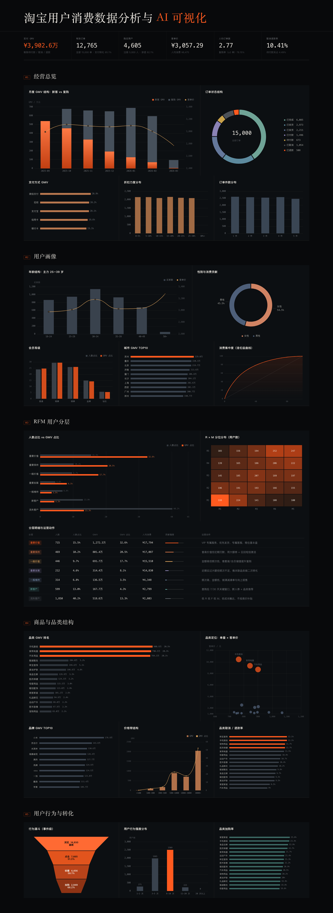

# 淘宝消费数据看板 · 暗色版

单文件离线看板：`dashboard.html`（约 1.0 MB，ECharts 与数据全部内联，双击即可打开，无网络依赖）。



## 怎么更新

### 一、数据更新（最常见）

把 `../boss爬虫/淘宝用户消费数据汇总/` 里的 6 个 CSV 换成新数据，然后**双击 `更新看板.command`**：

```
重算指标 → 生成 dashboard.html → 自动打开浏览器
```

也可以在终端里跑，或者指向另一个数据目录：

```bash
./更新看板.command                              # 用默认数据目录
./更新看板.command /绝对路径/新数据目录          # 用指定目录的 CSV
```

脚本会自动找一个装了 `pandas` 的 `python3`（优先 PATH，其次 miniconda）；找不到会提示安装。

### 二、只改视觉 / 文案

改 `template.html`（或 `data.json` 的字段用法）→ 双击 `更新看板.command`。
只想重新生成页面、不重算数据时：

```bash
python3 build.py
```

### 三、换一份数据源时要满足的字段

| 表 | 关键列 |
| --- | --- |
| `orders.csv` | `order_id, user_id, product_id, order_date, delivery_date, receive_date, order_status, quantity, unit_price, total_amount, discount, actual_payment, payment_method, review_score` |
| `users.csv` | `user_id, age, gender, member_level, city` |
| `products.csv` | `product_id, category, brand, price` |
| `user_behaviors.csv` | `behavior_id, user_id, product_id, behavior_type, behavior_time, duration_seconds` |
| `user_features.csv` / `product_features.csv` | 目前只用于质检行数统计，缺列不影响出图 |

- 编码按 UTF-8 with BOM（`utf-8-sig`）读取；`order_date` 等日期列需可被 pandas 解析。
- 少列会直接 `KeyError` 报错（不会静默出错）。
- 月份跨度变了不用改代码：x 轴与 `<title>` 里的期间都跟着数据走；RFM 的参考日取数据中最大下单日。
- 更新后浏览器里按 ⌘R 刷新；如果页面是旧的，关掉标签页重开。

### 四、手动分步（等价）

```bash
python3 analyze.py     # 6 张 CSV 全量重算 → data.json
python3 build.py       # 模板 + ECharts + data.json → dashboard.html
```

依赖：`pandas`（3.0.1 实测）。`build.py` 优先用 `assets/echarts.min.js`，缺失时回退 `/tmp/echarts.min.js`。

## 文件

| 文件 | 说明 |
| --- | --- |
| `analyze.py` | 数据清洗与全部指标重算，输出 `data.json` |
| `template.html` | 看板模板，占位 `/*__ECHARTS__*/` 与 `__DATA__` |
| `build.py` | 注入脚本与数据，产出单文件 HTML |
| `data.json` | 重算结果（KPI、月度、RFM、品类、行为、质检…） |
| `dashboard.html` | 交付物（离线可看） |
| `preview.png` / `preview-top.png` | 整页 / 首屏截图 |
| `更新看板.command` | 双击更新：重算 + 重新生成 + 打开 |
| `assets/echarts.min.js` | ECharts 5.5.1 源码（内联用；同目录 `echarts.min.js` 是运行时兜底） |

## 设计系统

- 底色 `#08090B`，卡片 `#0C0F12`，以 1px 细线（`rgba(237,233,226,.10)`）切分栅格，不使用圆角与阴影。
- 标题：Songti SC；数字与标签：SF Mono。版心 1460px，左右留白 44px。
- 单一强调色信号橙 `#FF5A1F`；辅助色为低饱和的 steel / teal / amber / mauve，只用于区分数据维度。
- 六个 KPI 改为「排版式数字 + 细线分隔」，避免卡片堆叠；每个 section 用方框编号 + 宋体大标题。
- 页面只有一块强调色（新客、重点品类、重点 RFM 层、GMV 数字）；不放氛围渐变、网格底纹、英文 kicker。

## 结构

1. Header：标题「淘宝用户消费数据分析与 AI 可视化」
2. KPI：实付 GMV / 有效订单 / 购买用户 / 客单价 / 人均订单 / 取消退款率
3. 01 经营总览：月度新客 vs 复购、订单状态、支付方式、折扣、件数
4. 02 用户画像：年龄、性别、会员、城市、消费集中度
5. 03 RFM：分层对比、R×M 热力图、分层明细与运营动作
6. 04 商品与品类：品类 GMV、单量×客单价、品牌、价格带、取消退款率
7. 05 行为与转化：事件级漏斗、行为强度、品类加购率
> 06 核心结论、07 数据质量两节，以及全部图表说明小字、章节说明、页脚已按需求删除。
> 口径与数据缺陷记录保留在本文件末尾。

## 口径提醒

金额统一取实付 `actual_payment`；有效订单 = 已付款 / 已发货 / 已收货 / 已完成。

数据存在生成器痕迹：订单时分秒恒为 22:38（小时维度不可用）、收藏/加购停留时长恒为 0、`province` 与 `city` 不对应（只用 city）、行为表与订单表独立生成（跨表漏斗无业务含义）。看板只做表内可验证的结论。
